<div align="center">

<picture>
  <source media="(prefers-color-scheme: dark)" srcset=".github/assets/banner-dark.svg">
  
</picture>

**Rooms, broadcasts, acknowledgements, and scale-out over native WebSockets.**<br>
An event-oriented API over PAM's RFC 6455 transport with authentication, bounded events, rooms, resume behavior, and Redis Streams/NATS adapters.

[](https://packagist.org/packages/pushinbr/pam-socket)

[](LICENSE)

[Install](#install) · [Quick example](#quick-example) · [API](#api-guide) · [Docs](#docs) · [Issues](https://github.com/push-in/pam-socket/issues)

</div>

<a id="install"></a>
## <picture></picture> Install

Create a realtime application with the `--socket` flag:

```sh
pam init realtime-api --template http --socket
cd realtime-api
pam dev
```

For Laravel, use `pam init realtime-laravel --template laravel --socket`. In an existing project, use `pam composer require pushinbr/pam-socket`. Run `pam doctor` after dependency changes and before creating a release.

<a id="quick-example"></a>
## <picture></picture> Quick example

```php
<?php

declare(strict_types=1);

use Pam\App;
use Pam\Http\Request;
use Pam\Http\Response;

$app = new App;

$socket = \Pam\Socket\Server::create();
$socket->on('connection', static function (\Pam\WS\Socket $client): void {
    $client->emit('welcome', ['message' => 'Connected to Pam Socket']);
});

$app->get('/api/ping', static fn (Request $request, Response $response): Response => $response->json([
    'message' => 'pong',
]));
$app->listen((int) (getenv('PAM_PORT') ?: 3000));
```

<a id="what-you-can-build"></a>
## <picture></picture> What you can build

- Chat, presence, and collaboration
- Realtime dashboards and notifications
- Multi-worker broadcasts coordinated through Redis Streams or NATS

| | |
| --- | --- |
| **Role** | Realtime framework |
| **Execution path** | PAM WebSocket transport · PHP event API |
| **This repository owns** | Application events, rooms, acknowledgements, and broadcast adapters |
| **Boundary** | Not wire-compatible with Socket.IO or Engine.IO clients |

<a id="api-guide"></a>
## <picture></picture> API guide

| Surface | Use it for |
| --- | --- |
| `Server::create()` | Create the event layer over PAM's native WebSocket server. |
| `on()` | Handle connection and application events. |
| `auth()` | Authenticate the connection before application events are accepted. |
| `emit()` | Broadcast an event to connected clients. |
| `to()` | Target a room through a `RoomEmitter`. |
| `adapter()` | Coordinate broadcasts across workers through supported Redis Streams or NATS adapters. |

PAM Socket uses standard RFC 6455 frames and its own event envelope. It is not an Engine.IO or Socket.IO server. Clients must implement the documented PAM event contract, acknowledgement identifiers, reconnect policy, and resume behavior.

<a id="production-checklist"></a>
## <picture></picture> Production checklist

- Keep request data and mutable state scoped to the current request.
- Test success, validation failure, exception, cancellation, and timeout paths.
- Configure explicit limits and avoid unbounded payloads, queues, or retained collections.
- Run `pam doctor`, `pam test`, and the relevant integration suite before release.
- Validate real dependencies and workload behavior; compatibility is not inferred from package installation alone.

**Troubleshooting**

- **Class not found:** run `pam composer install`, verify PSR-4 configuration, and rerun `pam doctor`.
- **Behavior differs over the network:** reproduce with PAM's transport integration tests; in-memory execution does not model the socket boundary.
- **A dependency blocks a worker:** use PAM-native I/O, a compatible event loop, a process pool, or additional isolated workers.

Report security vulnerabilities through GitHub private vulnerability reporting or the PAM security policy, not a public issue.

<a id="docs"></a>
## <picture></picture> Docs

- [Official documentation](https://push-in.github.io/pam-docs/packages/socket/)
- [Package ecosystem](https://push-in.github.io/pam-docs/packages/overview/)
- [Runtime compatibility](https://push-in.github.io/pam-docs/runtime/compatibility/)
- [Changelog](CHANGELOG.md)

<a id="pam-ecosystem"></a>
## <picture></picture> Part of the PAM ecosystem

PAM runs PHP natively on servers, desktops and phones. This repository is one piece of it.

| [**PAM**](https://github.com/push-in/pam) | [**PAM Desktop**](https://github.com/push-in/pam-desktop) | [**PAM Native**](https://github.com/push-in/pam-native) | [**Ecosystem**](https://github.com/push-in/pam#ecosystem) |
| --- | --- | --- | --- |
| the runtime and CLI | native desktop apps in PHP | native Android and iOS apps in PHP | every official package and plugin |

<sub>Docs: [push-in.github.io/pam-docs](https://push-in.github.io/pam-docs/introduction/) · [Issues](https://github.com/push-in/pam-socket/issues)</sub>

<p align="center"><sub><a href="LICENSE">Apache License 2.0</a>: use, modify and distribute for any purpose, including commercially · Made in Brazil by Pushin</sub></p>
